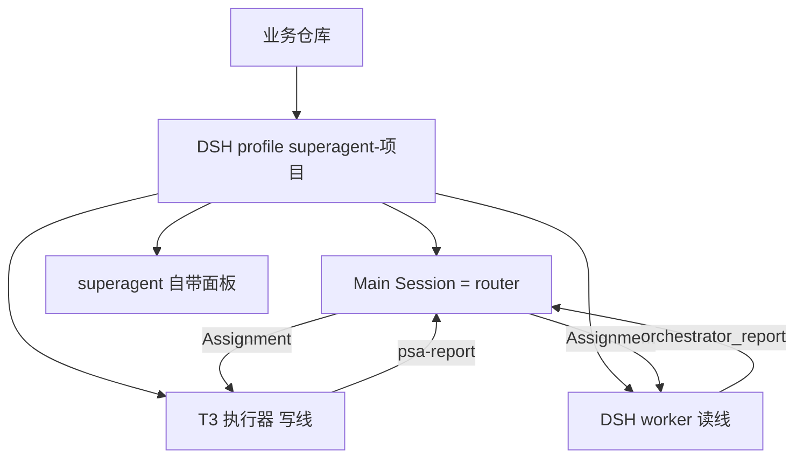
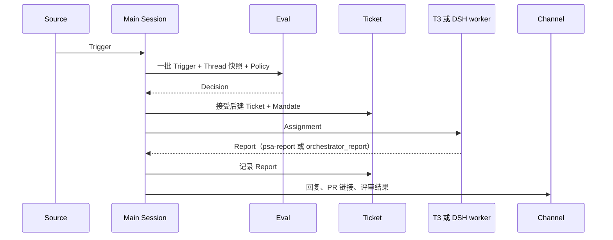

# 架构：一个项目一个实例

> 这份文档是 fork 的部署契约。领域术语以 `docs/001-domain.md` 为准。本文只说明我们怎么落地。

## 一句话

一个项目一个 superagent 实例。

实例 = 一个 DSH profile + 一个端口 + 一个 stateDir。

Main Session 就是这个项目的 router。

写线走 T3 执行器，最多 2 个。

读线走 DSH worker。

单项目详情看 superagent 自带面板。

跨项目总看板在 W3，不在实例里。

## 1. 实例边界

一个实例只服务一个项目、一个业务仓库。

第一版分配如下。端口和 stateDir 可以因为冲突调整，但调整后要写进 `deploy/projects.json`，之后不再随意改。

| 项目 | profile | 端口 | stateDir |
| --- | --- | --- | --- |
| FretSense | `superagent-fretsense` | `3082` | `~/.dsh/state/superagent-fretsense` |
| Delicacy | `superagent-delicacy` | `3083` | `~/.dsh/state/superagent-delicacy` |
| GuitarOS | `superagent-guitaros` | `3084` | `~/.dsh/state/superagent-guitaros` |
| DAWdex | `superagent-dawdex` | `3085` | `~/.dsh/state/superagent-dawdex` |
| mission | `superagent-mission` | `3086` | `~/.dsh/state/superagent-mission` |

`deploy/projects.json` 是实例清单的唯一来源。`scripts/instances.mjs` 按它启动、停止、查看状态。这两个文件由 W1 落地。

每个实例必须满足四条：

1. profile 名是 `superagent-<项目>`，不和主人平时用的 DSH profile 混在一起。
2. 端口只归这个实例用，不能两个实例抢一个端口。
3. stateDir 只归这个实例用，里面放数据库、锁、worker-bin、worker-gitconfig 和工单目录。
4. 一个项目只绑定一个业务仓库。GitHub Source 只听这个仓库，不跨项目收事件。
5. 每个实例用自己的 Source 身份，不共享主人的日常 GitHub/Feishu 登录。

为什么要分开：

- superagent 会改进程级 `PATH` 和 git 配置。和主人自己的 profile 混用，会污染日常会话。
- 每个实例有自己的 SQLite 和写锁。混用会变成多写者，直接坏数据。
- 一个实例升级、重启、出故障，不影响其他项目。

实例之间不共享数据库，不共享锁，不共享 Ticket。跨项目只看总看板。

## 2. 进程和角色

| 角色 | 位置 | 做什么 | 不做什么 |
| --- | --- | --- | --- |
| Main Session | 实例内的 router Session | 收 Trigger、跑 Eval、建 Ticket/Mandate、派 Assignment、回 Channel | 不直接改业务仓库 |
| T3 执行器 | 实例外的 T3 Code | 写代码、写文档、开 PR、跑测试 | 不建 Ticket，不改 Policy |
| DSH worker | 实例内的 worker Session | 调研、复核、复现、总结、看代码 | 不写业务仓库，不 push，不开 PR |
| 自带面板 | 实例的 `127.0.0.1:<port>` | 看单项目详情和健康状态 | 不做跨项目总看板 |

Main Session 是域状态的唯一入口。它通过 `orchestrator_*` 工具调用 Engine。其他角色都只提交事实，不直接写数据库。

Main Session 的工具面要收窄：

- shell 只读。
- fs 不可写。
- 不给业务仓库的写权限。
- 不替 T3 执行写操作。

这样 router 坏了，最多是路由错了，不会把仓库改坏。

## 3. 写线和读线

| 工作类型 | 走哪条线 | 执行器 | 能改仓库 | 并发 |
| --- | --- | --- | --- | --- |
| 写代码、写文档、开 PR、修 CI | 写线 | T3 执行器 | 能 | 每个实例最多 2 个 |
| 调研、复核、复现、读代码、总结 | 读线 | DSH worker | 不能 | 按实例的 `executor.maxWorkers` |

写线和读线各自排队。一个实例的最坏负载是 2 个写 Assignment 加 `maxWorkers` 个读 Assignment。机器吃不消，就调小 `maxWorkers`，不要偷偷超过写线的 2。

分流规则：

1. Eval 接受工作时，给 Mandate 加一个 `line` 字段：`write` 或 `read`。
2. 拿不准时按 `read` 走。读错了可以重派，写错了会污染仓库。
3. 只有主人明确要求写，或者 Policy 里写明的规则允许写，才给 `write`。
4. 写线满了，Ticket 停在 `pending` 排队。不把写工作降级给读线。
5. 读线满了，读工作也排队。不为了腾槽把读工作塞给 T3。

写线为什么每个实例最多 2 个：

- 同时开太多 T3 线程，主人看不过来，机器也扛不住。
- 第 3 个写 Assignment 不启动 T3 线程，留在 `pending`。
- 这是每个实例的上限，不是全局上限。五个实例不会共用一个 2 的配额。
- 这是部署配额，不是领域规则。领域里 Assignment 仍然是一个 Ticket 绑一个执行器实例。

T3 的硬约束：

- 一个 Ticket 同一时间只绑一个 T3 线程。一个 Assignment 只对应一个线程。
- 启动时带 `clientRequestId=assignment.id`。同一个 id 重试，返回同一个线程，不开第二个。
- 使用 `existing_worktree` 绑定已经准备好的工单目录。不要每个工单重新 clone。
- T3 用自己的 GitHub 身份，不用主人日常 `gh` 登录。
- 主人可以进 T3 线程接手。接手不取消 Assignment，报告仍要回到 router。

读线的硬约束：

- 一个 Ticket 一个 DSH worker Session。
- 工具里没有仓库写权限，没有 push，没有 PR。
- 结论必须回到 `orchestrator_report`。聊天里说完了不算。

## 4. 一条工作怎么走

1. Source 收到事件，先过滤自己的消息和不在监听范围内的事件。
2. Source 把事件翻译成 Trigger，并归到 Thread。
3. Trigger 先扇出给订阅了这个 Thread 的 Ticket。
4. 没有扇出，才进 Eval。Eval 决定接、停、忽略或未完成。
5. 接受时建 Ticket 和 Mandate。Mandate 记下 Policy 版本、范围、强度和依据。
6. Main Session 建 Assignment，按 `line` 选写线或读线。
7. 执行器干完，提交结构化 Report。
8. Main Session 把结果写回 Ticket，再通过 Channel 回到 Source。

写线的 Report 走 `psa-report`。读线的 Report 走 `orchestrator_report`。两边最后都变成同一个 Assignment Report。

## 5. 状态、重启和恢复

每个实例的 stateDir 里至少有：

| 路径 | 用途 |
| --- | --- |
| `orchestrator.sqlite` | 域状态，只有这个实例的 Store 能打开 |
| 锁文件 | 保证一个 stateDir 只有一个写者 |
| `worker-bin` | 命令 shim，限制 worker 能跑什么 |
| `worker-gitconfig` | worker 的 git 配置，不继承主人的全局配置 |
| `work/` | 工单目录和 worktree |

恢复规则：

1. 启动时先拿 stateDir 锁。拿不到就退出，不起第二个进程。
2. 重启只影响这个实例。其他项目的实例继续跑。
3. DSH 重启后，运行中的 Assignment 按 `docs/001-domain.md` 的 Assignment 规则恢复。
4. T3 线程不因为 DSH 重启就自动结束。恢复前先 `thread show` 看它停在哪，再决定续跑还是重派。
5. 升级前备份 `orchestrator.sqlite`。新版本迁移过的库，旧版本打不开。
6. `stateDir` 不在面板里改。要换目录，停实例、搬数据、改配置、再启动。

健康检查：

- 每个实例看自己的 `/orchestrator/api/state`。
- `scripts/dsh-superagent --profile superagent-<项目> status` 返回 0，才算正常。
- 返回 2 是部件坏了，重启不一定修好。
- 返回 3 是等 setup，重启修不好。

## 6. 面板

第一版不自己做单项目面板。

每个实例直接用 superagent 自带面板：

- Overview：现在有没有要人处理的事。
- Source：来源是否正常。
- Trigger：Thread 和 Trigger。
- Eval：Decision 和依据。
- Execution：Ticket、Assignment、执行器状态。
- Settings：Source、Eval、执行、Prompt、部署。

自带面板是单项目详情页。它回答“这个项目现在怎么样”。

跨项目总看板是 W3，回答“所有项目里，什么要我定、什么做完了、什么卡住了”。W3 只读聚合，不建第二份状态。具体契约见 `docs/BOARD_CONTRACT_面板契约.md`。

第一版不做：

- 不按项目改一套自定义面板。
- 不在实例里做全局看板。
- 不让面板直接改业务仓库。

## 7. 非目标

- 不做全局 router。每个项目自己路由。
- 不做跨项目 Ticket。项目之间只在总看板汇总。
- 不让总看板写状态。
- 不自动合并 PR。
- 不让 agent 自己触发自己。
- 不建第二份 Ticket/Assignment 状态库。
- 不把主人的日常 DSH profile 当 superagent 实例。

## 8. 检查

W1 检查：

- 五个 profile、五个端口、五个 stateDir 都能在清单里对上。
- 每个实例单独 `status` 返回 0。
- 启动或停止一个实例，其他实例不受影响。
- 同一个 stateDir 起第二个进程会被拒绝。

W2 检查：

- 两个写 Assignment 能同时跑。
- 第三个写 Assignment 停在 `pending`，没有开第三个 T3 线程。
- 同一个 `clientRequestId` 重试，只得到一个 T3 线程。
- T3 线程用的是 `existing_worktree`，没有重复 clone。
- T3 线程挂了，Assignment 报 `failed`，不会偷偷改写线为读线。

面板检查：

- 每个实例的自带面板能打开，Overview 能显示要人处理的事。
- W3 能读到每个实例的 `/orchestrator/api`。
- 停掉一个实例，W3 把它标成卡住，其他项目照常显示。
