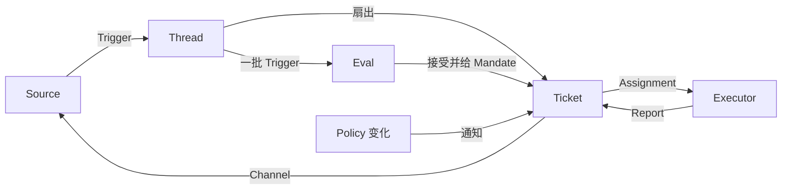

# 域契约：superagent 底座加我们的三块增量

> 领域对象以 `docs/001-domain.md` 为准。本文不另起一套名字，只写我们这边必须多守的规则。

## 一句话

底座有九个域对象：Source、Trigger、Thread、Ticket、Assignment、Subscription、Mandate、Eval、Policy。

我们只加三块：

1. T3 执行器，负责写线。
2. `psa-report`，负责把 T3 的结果变成结构化 Report。
3. baseline 的 `whoSaid`，负责分清“谁说的”。

除此之外，不改底座。

## 1. 工作流



顺序不能反：

- Source 产生 Trigger。
- Trigger 进 Thread。
- 已订阅的 Ticket 先拿扇出。
- 没有扇出的 Trigger 才进 Eval。
- 只有 Eval 能建 Ticket。
- 只有 Ticket 有 Mandate。
- Assignment 把 Ticket 绑到一个执行器实例。
- Report 回到 Ticket，再通过 Channel 回到 Source。

## 2. 九个域对象

### Source 来源

定义：一条事件流。Source kind 是可复用的实现；Source instance 是一次配置。

必须守：

- 记住自己的读取位置。重启不能重放旧事件。
- 有自己的机器人身份。
- 定义什么算一个事件。
- 在进入域之前，丢掉机器人自己的消息和不在监听范围内的事件。
- 把 Trigger 翻译成它所属的 Thread，以及回复用的 Channel 地址。

我们这边：

- 一个实例只听一个业务仓库。
- GitHub Source 的允许名单只在这个 Source 的身份里生效。
- 不同 Source 的身份不互相映射。

### Trigger 触发

定义：一条不可变事件，带 Source 自己的元数据，比如 actor。

必须守：

- 一个 Trigger 可以属于一个或多个 Thread。
- 同一个 Trigger 被接受两次，只建一个 Ticket。
- Trigger 是审计和幂等的单位。

我们这边：

- 总看板丢进来的东西，最后也要变成 Trigger。总看板自己不存工单。

### Thread 线程

定义：按时间排的 Trigger。哪些 Trigger 算同一个 Thread，由 Source 决定。

必须守：

- 同一时间最多一个 Eval 在跑。
- 一个 Thread 可以有多个 Ticket。
- Thread 持有它的 Subscription、正在跑的 Eval 和 Decision 历史。
- 后到的 Trigger 合并进下一批，不插队。

### Ticket 工单

定义：一个有授权的工作单位。

必须守：

- 只有 Eval 能建 Ticket。
- Ticket 引用 Mandate，持有 Channel 和 Input。
- 状态是 open → ended。人在它的 Thread 上说话，可以把它重新打开；但人明确停掉的除外。
- Ticket 自己定义状态，不跟着执行器 Session 的状态走。

我们这边：

- 写 Ticket 和读 Ticket 都是 Ticket。区别在 Mandate 新增的 `line` 字段，不是两种对象。
- 写线排队时，Ticket 还是 open，Assignment 是 pending。

### Assignment 派工

定义：一个 Ticket 绑到一个执行器实例。

必须守：

- 一个 Ticket 一生可以有多个 Assignment。
- 状态是 pending → running → ended，和 Ticket 的状态分开。
- 只有 Assignment 的最终 Report 才能从执行器这边结束 Ticket。

我们这边：

- 写 Assignment 绑 T3 线程。
- 读 Assignment 绑 DSH worker Session。
- 一个 Assignment 只属于一个执行器实例。

### Subscription 订阅

定义：Ticket 和 Thread 的多对多关系，由 Thread 持有。

必须守：

- 匹配的 Trigger 扇出给每个活着的订阅 Ticket，不检查是谁发的。
- 人通过扇出到达 Ticket 的消息，不再进 Eval。
- 执行器为了看上下文而关注的 Thread，也这样到达 Ticket，但不给授权，也不重新打开 Ticket。
- 已结束的 Ticket 保留订阅。包括已经关闭或合并的 PR。人在上面说话，可以用同一个 Mandate 重新打开，不再跑 Eval。
- 机器人和 CI 的消息不重新打开 Ticket。执行器恢复时自己重读 Thread。
- 被人停掉的 Ticket 什么都收不到。
- Main Session 只有在这条消息明确指向某个 Ticket 时，才把 Thread 挂到那个 Ticket。
- 人可以撤掉 Thread 上的全部订阅。
- 执行器只能撤自己 Ticket 的订阅，而且只能撤它认为无关的 Thread。Ticket 起始的 Thread 和 Source 让它关注的 Thread 不能撤。

### Mandate 授权

定义：Eval 接受工作时给出的东西。里面有 Policy 版本、范围、强度、命中的规则、发送者在该 Source 上的身份，以及 Source 怎么收到这条 Trigger。

必须守：

- 不可变。
- 范围变大，必须新建 Ticket，不能改旧 Mandate。
- Ticket 结束不等于 Mandate 结束。
- 只有人明确停止，才能撤回 Mandate。
- Policy 不再支持它时，Mandate 失效。
- 已结束的 Ticket 要恢复，先用当前 Policy 重新验证 Mandate。

我们这边：

- 底座的 `scope` 还是字符串，不改。另加一个 `line` 字段：`write` 或 `read`。
- `line=write` 才能派 T3 写线。
- `line=read` 只能派 DSH worker。

### Eval 评估

定义：对一批 Trigger 的判断，分两层：Gate 和 Assessment。

输入：

- Trigger 批次。
- Thread 快照。
- 这个 Thread 上的所有 Ticket，包括已结束的。
- 当前 Policy。

输出：一个 Decision。

必须守：

- Eval 不持有状态。
- 同一 Thread 串行跑。
- 规则变了，正在跑的 Eval 丢掉，用新 Policy 重跑。

### Policy 策略

定义：有版本的接受规则，加上每个 Source 的那一部分。

必须守：

- Policy 版本覆盖规则、接受模式和 Source 部分。
- 影响活 Ticket 的变化，要送到它的 Assignment，但不撤回 Mandate。
- 不同 Source 上的身份永远不互相映射。

## 3. Decision、Strength、Report

| 组 | 值 |
| --- | --- |
| Decision | `accept` 接单 · `stop` 停止 · `ignore` 忽略 · `unavailable` 未完成 |
| Strength | `explicit` 明确 · `inferred` 推断 |
| Assignment | `pending` 待启动 · `running` 执行中 · `ended` 已结束 |
| Report | `progress` 进展 · `waiting` 等待 · `ready` 就绪 · `blocked` 受阻 · `failed` 失败 · `dropped` 无需处理 |

Report 的意思不能混：

- `progress`：还在干。
- `waiting`：这一轮干完了，等下一个 Trigger 或 Input。不是等人。
- `ready`：结果好了。
- `blocked`：要人才能往下走。
- `failed`：执行失败，要人恢复。
- `dropped`：没有剩余工作。

## 4. 增量一：T3 执行器

T3 是 Executor 端口的一个实现。它不是新的域对象。

### 生命周期

T3 执行器要实现三个动作：

| 动作 | 做什么 |
| --- | --- |
| `start` | 为 Assignment 开一个 T3 线程 |
| `deliver` | 把新 Input 送进现有 T3 线程 |
| `stop` | 停止当前 Assignment，保留线程记录 |

### 绑定规则

1. 一个 Ticket 同一时间只开一个 T3 线程。
2. `start` 必须带 `clientRequestId=assignment.id`。
3. 同一个 `clientRequestId` 重试，返回同一个线程，不开第二个。
4. 使用 `existing_worktree` 绑定已经准备好的工单目录。
5. 一个工单一个 worktree。不要每个 Assignment 重新 clone。
6. 新 Assignment 恢复旧 Ticket 时，用 `deliver` 发到旧线程，不重新 `start`。
7. T3 线程 id 要记在 Assignment 的 `t3ThreadId` 字段上。总看板靠它跳转，不靠时间猜。

### 权限

- T3 用独立的 GitHub 身份，不用主人日常 `gh` 登录。
- 用 `GH_CONFIG_DIR` 指向独立配置。不要把主人的 `GH_TOKEN` 或 `GITHUB_TOKEN` 带进 T3 线程。
- 写线同时最多 2 个 Assignment。这是部署配额，不是域规则。
- 第 3 个写 Assignment 停在 `pending`，不开 T3 线程。
- 写线满了，不能把写工作改成读工作。

### 结束

- T3 提交最终 Report 后，Assignment 可以结束。
- Ticket 是否结束，仍按底座规则：看它关注的 Thread、人的停止、以及最终 Report 的状态。
- `dropped` 可以结束 Ticket。
- `ready` 只在 Ticket 没有关注的 Thread，或关注的 Thread 都结束时，才结束 Ticket。
- `blocked` 和 `failed` 不结束 Ticket，等人。

## 5. 增量二：psa-report 协议

`psa-report` 是 T3 线程回给 router 的结构化报告。

聊天里说“做完了”不算。必须有 JSON。

### 传输

两种传法，同一份 schema：

- T3 里的 MCP 工具。
- T3 里的 `psa-report` 命令。

router 收到后，先校验 `assignmentId` 对应当前 running Assignment，再调用 `Engine.report(ticketId, report)`。

### JSON

```json
{
  "reportId": "rpt_01",
  "assignmentId": "asg_01",
  "ticketId": "tkt_01",
  "state": "ready",
  "final": true,
  "summary": "PR #123 已开，测试通过",
  "at": "2026-11-07T12:00:00Z",
  "evidence": [
    "https://github.com/Javey-Li/FretSense/pull/123"
  ],
  "question": null,
  "next": "等人看 PR"
}
```

### 字段

| 字段 | 必填 | 说明 |
| --- | --- | --- |
| `reportId` | 是 | 这份报告的 id。重复提交同一份，只记一次 |
| `assignmentId` | 是 | 必须等于 T3 启动时的 `clientRequestId` |
| `ticketId` | 是 | 必须和 Assignment 上的 Ticket 一致 |
| `state` | 是 | 只用底座那六个 Report 值 |
| `final` | 否 | 只有 `ready` 或 `dropped` 可以为 `true` |
| `summary` | 是 | 一到三句白话。写发生了什么，不写内部术语 |
| `at` | 是 | 这份报告的时间 |
| `evidence` | 否 | PR、commit、文件、测试结果、截图。没有链接的结论不算完成 |
| `question` | 否 | 要人回答时用结构化字段，不埋在 summary 里 |
| `next` | 否 | 下一步谁做什么 |

`final` 只属于 `psa-report`。落到底座 Report 时只保留 `state`、`summary`、`at`。`final` 由 router 用来决定 Assignment 是否结束。

`question` 长这样：

```json
{
  "text": "这个改动要不要兼容旧数据？",
  "options": ["兼容", "不兼容"],
  "blocking": true
}
```

### 规则

1. `assignmentId` 对不上，拒收，记健康错误。
2. `ticketId` 对不上，拒收，记健康错误。
3. 同一个 `reportId` 重复提交，忽略。
4. 比当前 Report 更旧的 `at`，不覆盖新 Report。
5. `final=true` 之后，同一 Assignment 不能再收 `progress`。要继续干，开新 Assignment。
6. `blocked` 和 `failed` 必须带 `question`，或者带清楚的 `next`。否则总看板不知道该谁处理。
7. Report 是事实，不是授权。它不能扩大 Mandate，不能建 Ticket，不能把 AI 记录升成主人的决定。
8. 没有 `evidence` 的“完成”，只能算 `progress` 或 `waiting`，不能算 `ready`。

### 和底座的对应

| psa-report | 底座 Report | 总看板归到 |
| --- | --- | --- |
| `progress` | `progress` | 不单独出现 |
| `waiting` | `waiting` | 不单独出现 |
| `ready` | `ready` | 要我定的（等你确认） |
| `blocked` | `blocked` | 要我定的 |
| `failed` | `failed` | 要我定的 |
| `dropped` | `dropped` | 做完的 |

## 6. 增量三：baseline 的 whoSaid

baseline 是项目旁的记录库，不是域对象。

它帮 router 和 worker 记住“主人说过什么”。它不授权，也不产生 Mandate。

### 记录字段

| 字段 | 说明 |
| --- | --- |
| `id` | 记录 id |
| `projectId` | 哪个项目 |
| `type` | Intent、Decision、Failure、Guard、Reference、Pattern、Example、OpenQuestion、ProjectState |
| `title` | 一句话标题 |
| `claim` | 具体内容 |
| `whoSaid` | 谁说的，只用下面三个值；由 `authority` 推出 |
| `whoSaidLabel` | 中文标签，只读出来，不落库 |
| `author` | 字是谁写的：`human`、`ai`、`mixed` |
| `authority` | 算不算主人的决定：`owner-original`、`owner-approved`、`none` |
| `evidence` | 怎么知道的：`stated`、`observed`、`relayed`、`inferred` |
| `verbatim` | 主人的逐字原话 |
| `summary` | AI 的总结或转述，和原话分开存 |
| `approvedFrom` | 主人贴回 AI 稿时的来源；显式表示“我认可这段” |
| `parts` | 混合作者记录的分段，每段带自己的 `author`、`authority`、`verbatim` 或 `summary` |
| `provenance` | 来源：原话链接、日期、文件、对话 id |
| `confidence` | 置信度 |
| `status` | `active`、`promoted`、`superseded` |
| `scope` | 生效范围 |
| `normative` | 能不能当规范用 |
| `ttlDays` | 多少天后算旧 |
| `lastVerified` | 最后一次核对时间 |
| `supersedes` | 取代哪条旧记录 |
| `createdAt` | 创建时间 |

### whoSaid 只有三个值

| 值 | 中文 | 什么时候用 |
| --- | --- | --- |
| `founder-original` | 你的原话 | 有原话、有出处；必须带 `verbatim`，或者显式标 `paraphrase` |
| `founder-approved-ai` | 你认可的 AI 建议 | AI 先写，主人明确说“可以”“就这么办”，或者把 AI 稿贴回来并标 `approvedFrom`。要同时记 AI 稿和主人认可 |
| `ai-record` | AI 的记录（不是主人的决定） | AI 自己推断、总结、转述 |

`whoSaid` 是读出来的视图，权威字段是 `authority`：

- `authority=owner-original` → `founder-original`
- `authority=owner-approved` → `founder-approved-ai`
- `authority=none` → `ai-record`

从 GitHub 作者自动判断时，只设置 `author`：

- 主人账号 → `author=human`，`authority` 仍是 `none`。
- 其他账号 → `author=ai`，`authority=none`。
- 主人可能原样贴回 AI 稿，所以账号本身不能直接给 `owner-original`。要标 `approvedFrom`，或显式传 `authority=owner-original` 且带 `verbatim`。
- `founder-approved-ai` 只能由主人明确确认后写入，不能靠账号自动判断。

混合作者用 `parts[]`，每段各算各的；整条记录取最高一级：有 `owner-original` 段就是 `founder-original`，否则有 `owner-approved` 段就是 `founder-approved-ai`，全是 AI 段就是 `ai-record`。

`normative` 的规则：

- 只有 Intent、Decision、Guard、Pattern 可以规范。
- `whoSaid=ai-record` 永远不算规范，即使类型是 Decision，即使调用方传了 `normative=true`。
- `Example` 永远不算规范。

### 晋升规则

1. `ai-record` 永远不能直接晋升。
2. 主人重复听到一句话，不等于主人认可。
3. router 转述一遍，不等于主人原话。
4. Report 里出现，不等于主人决定。
5. `ai-record` 要变成主人的决定，必须由主人明确确认，新建一条 `founder-original` 或 `founder-approved-ai`。
6. `Example` 和非规范记录不能直接晋升。要晋升，先新建 Decision。
7. 规范类型只有：Intent、Decision、Guard、Pattern。
8. 没有出处的记录，不能标 `founder-original`。
9. `ai-record` 不能自动算规范记录；查询规范记录时默认把它排除。

### 新旧和冲突

- 默认 90 天算旧。Failure 可以 365 天。
- 旧的规范记录不拿来当依据，先核对。
- 新记录声明 `supersedes=旧 id` 时，旧记录统一标 `status=superseded`，新记录保留 `supersedes` 指回旧记录。
- 默认查询不返回 `superseded`；要看历史，显式传 `includeSuperseded`。
- `superseded` 记录不能晋升，也不能再被另一条记录取代。
- `ai-record` 不能取代旧记录；取代必须由主人确认。
- 同一范围出现两条冲突记录，不覆盖，开一条 `OpenQuestion`，进总看板的“要我定的”。
- 主人现在的原话，优先级高于旧 baseline。
- Policy 和 Mandate 管“能不能做”。baseline 管“以前怎么想、怎么说”。两者不能互相替代。
- 全局决定用 `projectId="*"` 存；按项目查询时先读本项目，再读全局。

## 7. 明确不要的东西

| 不要 | 原因 |
| --- | --- |
| 第二套 Ticket/Assignment 状态 | 总看板只读，实例是唯一状态源 |
| 把 psa-report 当授权 | Report 只是事实，授权只来自 Mandate |
| 把 baseline 当 Policy | baseline 不决定谁能派活 |
| 跨项目合并 Ticket | 项目独立，只在总看板汇总 |
| 用时间猜 T3 线程和 Assignment 的对应 | 必须有 `t3ThreadId` |
| 让 AI 记录自动升级 | 主人的决定必须由主人确认 |

## 8. 最小检查

实现和评审时，至少检查这些：

- 同一个 Trigger 接受两次，只有一个 Ticket。
- 同一 Thread 的 Eval 不并行。
- 被停掉的 Ticket 收不到新消息。
- Policy 变化只通知活 Assignment，不撤回 Mandate。
- 同一个 `clientRequestId` 只开一个 T3 线程。
- 同一个 `reportId` 只记一次。
- `final=true` 后同一 Assignment 不再收 `progress`。
- `ai-record` 晋升会报错。
- 冲突 baseline 不覆盖，只开 OpenQuestion。
- 不同项目的 id 不互相映射。
